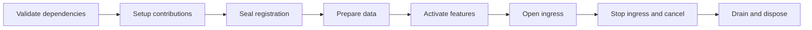

# Databehave

Compose deterministic data generation and mock HTTP applications from explicit plugins.

Databehave has a small lifecycle host. Schema generation, HTTP, OpenAPI, request validation, logging,
CORS, fault injection and the admin UI live behind public extension contracts. Official and external
plugins use the same contracts. A schema-only application needs no HTTP server; an HTTP-only
application needs no schema library or admin assets.

| Package | Responsibility |
| --- | --- |
| `@databehave/core` | Typed capabilities, dependency validation, registration and resource lifecycle |
| `@databehave/schema` | Instance-scoped schema kinds/behaviors, typed builders, deterministic generation and validation |
| `@databehave/server` | HTTP pipeline, routes, Node listener, optional CORS and access logging |
| `@databehave/openapi` | OpenAPI catalog, selectable generators, request validation and mock policies |
| `@databehave/admin` | Fault controls, scenarios, optional admin UI and optional browser opener |
| `@databehave/cli` | Explicit ESM configuration and signal handling |

## Start a mock server

The upcoming release requires Node.js 24 or 26. Supported and tested majors are 24 and 26;
Node.js 18, 20 and 22 are no longer supported. Newer majors are not covered until added to the test matrix.

```sh
npm install --save-dev @databehave/core @databehave/server @databehave/cli
```

```js
// databehave.mjs
import { defineConfig } from '@databehave/cli'
import { httpPlugin, routesPlugin, nodeHttpPlugin } from '@databehave/server'

export default defineConfig(() => ({
  plugins: [
    httpPlugin(),
    routesPlugin({
      'GET /hello': () => ({ json: { message: 'hello' } }),
    }),
    nodeHttpPlugin({ host: '127.0.0.1', port: 8000 }),
  ],
}))
```

Save the configuration as `databehave.mjs`, then run:

```sh
npx databehave ./databehave.mjs
```

The configuration factory creates fresh plugin instances. Install and import optional features explicitly.
Configuration and plugins are trusted application code; capabilities describe dependencies, not sandbox permissions.

## Plugin lifecycle



Dependencies determine initialization order. HTTP stages separately determine request order. Duplicate providers,
missing dependencies, incompatible contract versions and cycles fail explicitly. A failed application cleans up its
acquired resources; shutdown is idempotent. Create a new host to restart.

For programmatic use, call `createHost({ plugins })`, await `host.start()`, obtain a typed capability with
`host.get(token)`, and await `host.close()` in `finally`. Pure schema use stays synchronous through
`createSchemaRuntime({ kinds, behaviors })`.

## Documentation

- [Documentation hub](docs/index.md)
- [Writing plugins](docs/plugins.md)
- Runnable examples: [plugin](examples/plugin.mjs), [schema](examples/schema.mjs), [HTTP](examples/http.mjs)
- [Migration from the previous API and JSONC configuration](MIGRATION.md)
- [Core plugin API](packages/core/README.md)
- [Schema plugins](packages/schema/docs/extending.md)
- [HTTP plugins](packages/server/README.md)
- [OpenAPI plugins](packages/openapi/README.md)
- [Admin plugins](packages/admin/README.md)
- [CLI](packages/cli/README.md)
- [Release and runtime support guide](docs/releasing.md)

## Development

One `container` service provides Node, pnpm, TypeScript, the language server and headless Chromium for all six packages.
Compose generates container names from the project, service and instance number (normally `databehave_container_1`).
Run Compose from the real checkout root, not a symlinked path. It uses the shell's existing `PWD` to mount the checkout
at the same path inside the container and label it for Neovim; no environment-variable setup or path edits are needed.

```sh
podman compose up -d --build container
podman compose exec -T container pnpm install --frozen-lockfile
podman compose exec -T container pnpm build
podman compose exec -T container pnpm typecheck
podman compose exec -T container pnpm test
podman compose exec -T container pnpm lint
podman compose exec -T container pnpm test:e2e
podman compose down
```

For an agent's separate worktree, run Compose from that worktree's real root with a unique project name, for example
`podman compose -p databehave-agent-task1 up -d --build container`. Use the same `-p` value for its `exec` and `down`
commands. This keeps its containers and network separate and mounts that worktree instead of the main checkout.

`containers/Containerfile` defines the toolchain. Root-level `compose.yaml` keeps the startup command short, and
`.containerignore` stays at the build-context root to allow only the Containerfile and shared actionlint installer.
Source and dependencies stay in the mounted checkout. The service stays
running for editor tools and `exec` commands; it does not start an application server or install dependencies on startup.

Run `pnpm api:check`, `pnpm docs:check`, `pnpm examples:check`, `pnpm test:tooling` and `pnpm workflow:check`
in the development container. Package checks consume a prepared bundle with
`pnpm pack:check artifacts/release SOURCE_SHA`; see the [release guide](docs/releasing.md) for preparation commands. Browser tests use isolated headless profiles,
loopback applications and synthetic scenarios at desktop and narrow viewports.
