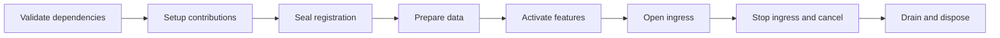

# Databehave

Compose deterministic data generation and mock HTTP applications from explicit plugins.

Databehave has a small lifecycle host. Schema generation, HTTP, OpenAPI, request validation, logging,
CORS, fault injection and the admin UI live behind public extension contracts. Official and external
plugins use the same contracts. A schema-only application needs no HTTP server; an HTTP-only
application needs no schema library or admin assets.

| Package | Responsibility |
| --- | --- |
| `@databehave/core` | Typed capabilities, dependency validation, registration and resource lifecycle |
| `@databehave/schema` | Instance-scoped schema kinds/behaviors, typed builders, deterministic generation and validation |
| `@databehave/server` | HTTP pipeline, routes, Node listener, optional CORS and access logging |
| `@databehave/openapi` | OpenAPI catalog, selectable generators, request validation and mock policies |
| `@databehave/admin` | Fault controls, scenarios, optional admin UI and optional browser opener |
| `@databehave/cli` | Explicit ESM configuration and signal handling |

## Start a mock server

The upcoming release requires Node.js 24 or 26. Supported and tested majors are 24 and 26;
Node.js 18, 20 and 22 are no longer supported. Newer majors are not covered until added to the test matrix.

```sh
npm install --save-dev @databehave/core @databehave/server @databehave/cli
```

```js
// databehave.mjs
import { defineConfig } from '@databehave/cli'
import { httpPlugin, routesPlugin, nodeHttpPlugin } from '@databehave/server'

export default defineConfig(() => ({
  plugins: [
    httpPlugin(),
    routesPlugin({
      'GET /hello': () => ({ json: { message: 'hello' } }),
    }),
    nodeHttpPlugin({ host: '127.0.0.1', port: 8000 }),
  ],
}))
```

Save the configuration as `databehave.mjs`, then run:

```sh
npx databehave ./databehave.mjs
```

The configuration factory creates fresh plugin instances. Install and import optional features explicitly.
Configuration and plugins are trusted application code; capabilities describe dependencies, not sandbox permissions.

## Plugin lifecycle



Dependencies determine initialization order. HTTP stages separately determine request order. Duplicate providers,
missing dependencies, incompatible contract versions and cycles fail explicitly. A failed application cleans up its
acquired resources; shutdown is idempotent. Create a new host to restart.

For programmatic use, call `createHost({ plugins })`, await `host.start()`, obtain a typed capability with
`host.get(token)`, and await `host.close()` in `finally`. Pure schema use stays synchronous through
`createSchemaRuntime({ kinds, behaviors })`.

## Documentation

- [Documentation hub](docs/index.md)
- [Writing plugins](docs/plugins.md)
- Runnable examples: [plugin](examples/plugin.mjs), [schema](examples/schema.mjs), [HTTP](examples/http.mjs)
- [Migration from the previous API and JSONC configuration](MIGRATION.md)
- [Core plugin API](packages/core/README.md)
- [Schema plugins](packages/schema/docs/extending.md)
- [HTTP plugins](packages/server/README.md)
- [OpenAPI plugins](packages/openapi/README.md)
- [Admin plugins](packages/admin/README.md)
- [CLI](packages/cli/README.md)
- [Release and runtime support guide](docs/releasing.md)

## Development

The project development container owns Node, pnpm, TypeScript, the language server and headless Chromium.
It mounts this checkout at its canonical absolute path. If checking out elsewhere, update the Compose working
directory, bind source/target and `io.dotfiles.project-root` label together.

```sh
env -u CONTAINER_CONNECTION -u DOCKER_HOST podman-compose --env-file /dev/null build
env -u CONTAINER_CONNECTION -u DOCKER_HOST podman-compose --env-file /dev/null up -d
env -u CONTAINER_CONNECTION -u DOCKER_HOST podman-compose --env-file /dev/null exec -T development pnpm install --frozen-lockfile
env -u CONTAINER_CONNECTION -u DOCKER_HOST podman-compose --env-file /dev/null exec -T development pnpm build
env -u CONTAINER_CONNECTION -u DOCKER_HOST podman-compose --env-file /dev/null exec -T development pnpm typecheck
env -u CONTAINER_CONNECTION -u DOCKER_HOST podman-compose --env-file /dev/null exec -T development pnpm test
env -u CONTAINER_CONNECTION -u DOCKER_HOST podman-compose --env-file /dev/null exec -T development pnpm lint
env -u CONTAINER_CONNECTION -u DOCKER_HOST podman-compose --env-file /dev/null exec -T development pnpm test:e2e
env -u CONTAINER_CONNECTION -u DOCKER_HOST podman-compose --env-file /dev/null down
```

Run `pnpm api:check`, `pnpm docs:check`, `pnpm examples:check`, `pnpm test:tooling` and `pnpm workflow:check`
in the development container. Package checks consume a prepared bundle with
`pnpm pack:check artifacts/release SOURCE_SHA`; see the [release guide](docs/releasing.md) for preparation commands. Browser tests use isolated headless profiles,
loopback applications and synthetic scenarios at desktop and narrow viewports.
